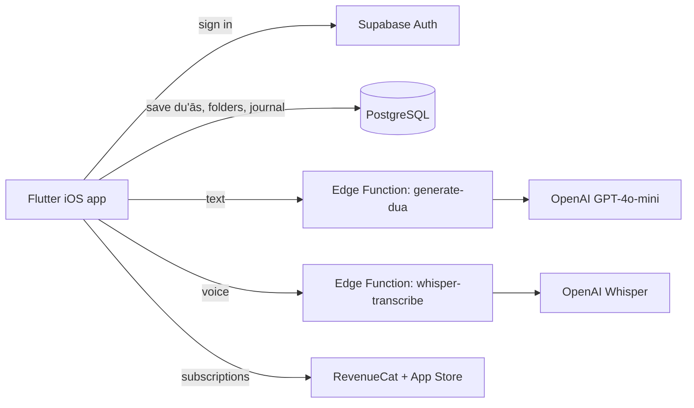

# Munājāt: Du'ā Studio

An iOS app that turns whatever someone types or says about their worries into a personal prayer (a du'ā), written in their own language.

**Live on the App Store:** https://apps.apple.com/gb/app/munajat-dua-studio/id6759813811

Designed and built solo, from idea in late November 2025 to launch during Ramadan 2026. As of November 2026: **268 users and 6 active paying subscribers**, with one TikTok ad as the only paid marketing.

This repository holds the full source: the Flutter app in `lib/`, the Supabase Edge Functions in `lib/supabase/functions/` and the database migrations in `supabase/migrations/`. The production system prompt is kept private, so `generate-dua/index.ts` contains a short placeholder in its place.

---

## Screenshots

| Onboarding | Create a du'ā | Your du'ā | Subscription |
|---|---|---|---|
|  |  |  |  |

---

## What it does

- **Type or speak.** Users write what's on their heart, or say it out loud. Voice is transcribed with Whisper.
- **A personal prayer, in their language.** The app writes a du'ā that responds to what they actually said.
- **Save and organise.** Du'ās can be saved into folders, alongside a private journal.
- **Free trial, then subscription.** Monthly or yearly plans through the App Store.

---

## How it's built

| Layer | Tools |
|---|---|
| App | Flutter (Dart), built with DreamFlow |
| Design | Wireframed in Figma Make |
| Backend | Supabase: authentication, PostgreSQL with row-level security, Edge Functions (TypeScript) |
| AI | OpenAI GPT-4o-mini for writing, Whisper for voice |
| Payments | RevenueCat and App Store subscriptions |
| Testing | On-device through TestFlight, against a written test checklist |

---

## Decisions I'm proud of

**Let people try it before signing up.** An early user told me he hadn't realised he had to sign up before he could try the app. I redesigned onboarding so a new user writes their first du'ā straight away, and is only asked to create an account when they choose to save it. Sign-up went from eight fields to five, with date of birth, gender and country removed.

**Privacy and consent first.** Apple's review raised three guideline issues, including how the app disclosed its use of AI. I added a clear consent step before a user's first du'ā, fixed each issue, and the app was approved at build 18.

**A prompt with guardrails.** The system prompt sets out theology rules, an eight-part structure for every du'ā, and filtering that turns harmful or despairing input into repentance and hope. I tested it across hundreds of generations and rewrote what failed.

**Security on the server.** The OpenAI key never touches the app. All AI calls go through Supabase Edge Functions, which check the user's sign-in and subscription before generating anything.

---

## How I built it

I'm a former cell therapy scientist, and this was my first mobile app. I built it with AI tools: Claude to plan each change, DreamFlow to apply it, and Claude Code to audit the codebase. Every decision, test and fix was mine.

**Status:** live on iOS. Android release in progress.

---

Built by **Qamar Hussain**, Manchester · [LinkedIn](https://www.linkedin.com/in/qamar-hussain-62646966)
